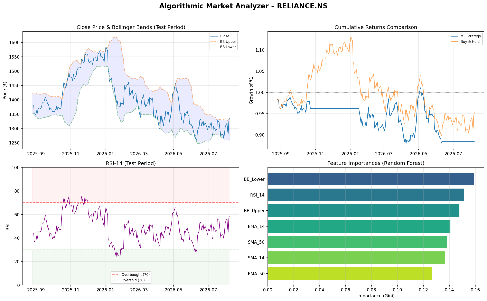
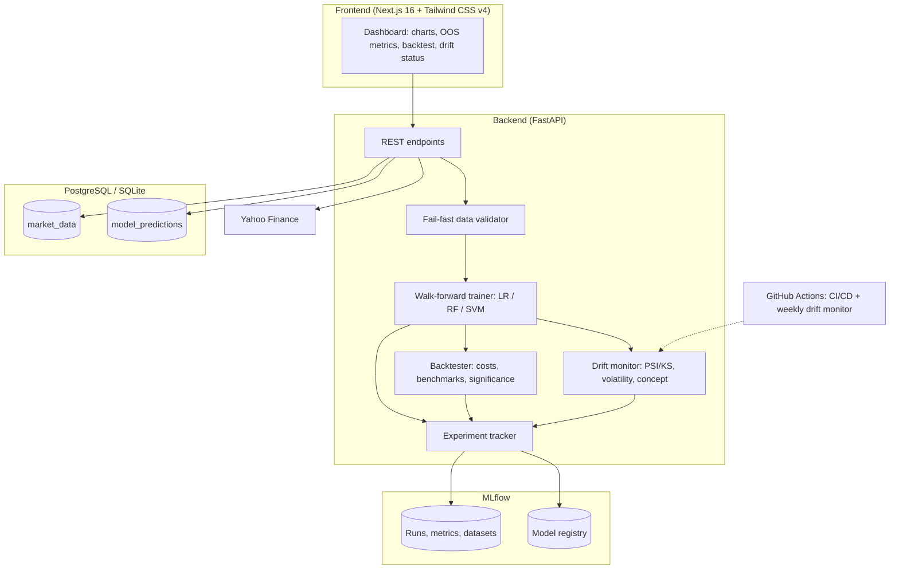
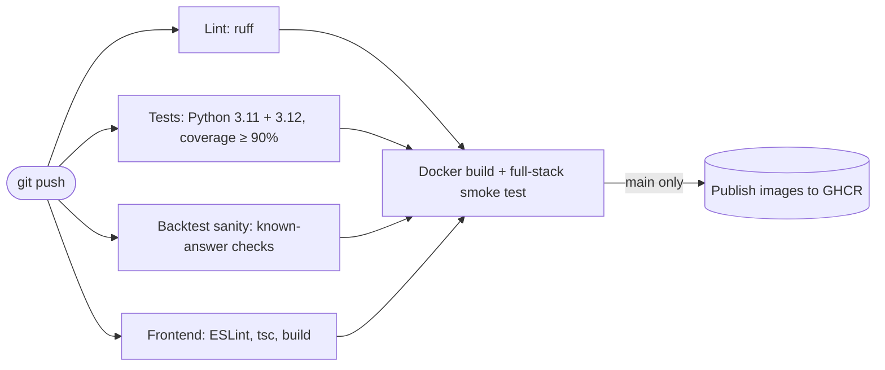

# Algorithmic Market Analyzer & Trade Classifier

[](https://github.com/Ayan13sp/Algorithmic_Market_Analyzer/actions/workflows/ci.yml)
[](https://github.com/Ayan13sp/Algorithmic_Market_Analyzer/actions/workflows/drift-monitor.yml)
[](https://www.python.org/downloads/)
[](https://nextjs.org/)
[](https://fastapi.tiangolo.com/)
[](backend/tests/)
[](backend/tests/)

A full-stack quantitative research and machine-learning platform for Indian equities (NSE & BSE). It downloads multi-year OHLCV data from Yahoo Finance, engineers 16 scale-free technical features, and validates three classifiers with **expanding-window walk-forward validation**. It then backtests the out-of-sample signals **net of realistic NSE transaction costs**, with significance tests, and **monitors data, volatility and concept drift**. Results appear in a Next.js dashboard built on TradingView Lightweight Charts, every run is tracked in MLflow, and a GitHub Actions pipeline tests, validates and containerises it on every push.

**Live demo:** [Dashboard](https://banking-frontend-46vb.onrender.com/) · [API docs (Swagger)](https://banking-backend-ce7i.onrender.com/docs). Hosted on Render's free tier: the services sleep when idle, so the first load can take a minute or two.



*Output of the standalone prototype `scripts/market_analyzer.py` on RELIANCE.NS: Bollinger Bands, ML vs buy-and-hold cumulative returns, RSI-14, and Random Forest feature importances.*

---

## Key Highlights

- **Walk-forward validation, not a single split.** Every quarter the model is refit on all prior data. The model family (Logistic Regression, Random Forest or SVM) and its hyperparameters are re-selected by cross-validated **balanced accuracy on past data only**, never by test performance.
- **Realistic execution and costs.** A signal from day T's close trades day T+1 (buy the open, sell the close), paying about 12.8 bps per round trip: brokerage, exchange and SEBI fees, GST, STT, stamp duty and slippage. Cost and decision-threshold sensitivity are reported, along with the break-even edge per trade.
- **Statistics a quant reviewer asks for:**
  - Sharpe ratio with a 95% confidence interval (Lo, 2002)
  - permutation test against random timing
  - exact McNemar test against a majority-class baseline
  - Sortino, maximum drawdown and Calmar
- **Leakage proofs, not just claims.** Tests scramble all prices after a cut-off and assert that every earlier feature, label and walk-forward prediction stays bit-identical.
- **Calibrated drift monitoring.** PSI and KS per feature, a volatility-regime check and a concept-drift test, each judged against its own historical distribution. This matters because market features are autocorrelated: naive tests raise false alarms constantly ([benchmark](#drift-monitoring)). A weekly GitHub Action fails, and notifies the owner, when a stock drifts.
- **Known-answer validation.** On synthetic markets the pipeline must find nothing in a random walk and recover a planted edge. Those checks run in CI on every push.
- **MLflow experiment tracking.** Each analysis logs walk-forward folds, dataset digests, candidates as nested runs, backtest and drift metrics, and the production model in the Model Registry.
- **Dual verification.** Moving averages are computed both in pandas and with SQL window functions (`AVG(close_price) OVER (… ROWS BETWEEN 13 PRECEDING AND CURRENT ROW)`). An API test asserts that they agree.

---

## Results (out of sample, net of costs)

Walk-forward over 10 years of daily data (about 1,760 out-of-sample days and 28 folds per stock, through 2026-11-20), with every prediction made by a model trained and selected only on earlier data. Full report: [docs/EVALUATION.md](docs/EVALUATION.md), generated by `python -m experiments.evaluate`.

| Ticker | Balanced acc. | ROC AUC | McNemar p | Net Sharpe [95% CI] | Gross Sharpe | Permutation p | Gross edge / trade |
|---|---|---|---|---|---|---|---|
| RELIANCE.NS | 0.508 | 0.512 | 0.78 | −1.40 [−2.14, −0.66] | −0.60 | 0.30 | −3.4 bps |
| TCS.NS | 0.513 | 0.515 | 0.83 | −1.42 [−2.16, −0.67] | −0.70 | 0.23 | −4.1 bps |
| INFY.NS | 0.495 | 0.488 | 0.91 | −1.62 [−2.36, −0.87] | −0.65 | 0.71 | −2.1 bps |
| HDFCBANK.NS | 0.504 | 0.490 | 0.55 | −1.37 [−2.11, −0.62] | −0.29 | 0.26 | 1.2 bps |
| ICICIBANK.NS | 0.528 | 0.531 | 0.055 | −0.56 [−1.30, 0.18] | 0.23 | 0.029 | 9.6 bps |

**What this says:**
- **No edge after costs.** Daily technical indicators do not predict the next session's direction for NSE large caps once leakage is removed. Balanced accuracy is 0.495–0.528 (chance is 0.500), no stock beats its majority-class baseline at the 5% level, and no net Sharpe confidence interval lies above zero.
- **Costs dominate.** The gross edge per trade (−4.1 to +9.6 bps) is below the 12.8 bps round-trip cost for every stock. ICICIBANK.NS has the only nominally significant timing result (permutation p = 0.029), but with five stocks tested that is about what chance alone produces.
- **The pipeline can find an edge when one exists.** On a synthetic market with a planted edge it reaches balanced accuracy 0.623, AUC 0.639 and McNemar p < 0.0001, and on a pure random walk it finds nothing (balanced accuracy 0.510, permutation p = 0.41). So the null result reflects the market, not a broken pipeline.
- **The drift monitor flags real conditions.** It currently reports concept-drift alerts for HDFCBANK.NS and ICICIBANK.NS: the out-of-sample error rate rose to ~60% over the last quarter (p < 0.05). RELIANCE.NS gets a volatility warning: 29.8% vs 20.7% annualised, the highest quarter in two years, but below the 1.5× alert threshold.

---

## Architecture



---

## Tech Stack

| Layer | Technology | Key Capabilities |
|---|---|---|
| **Frontend** | Next.js 16 (App Router), React 19, TypeScript | Tailwind CSS v4, responsive dashboard |
| **Charting** | TradingView Lightweight Charts | Candlesticks, indicator overlays, net vs gross equity curves |
| **Backend API** | FastAPI, Pydantic v2, Python 3.11+ | Typed request/response validation, 404/422/500 error mapping, CORS |
| **ML & Quant** | scikit-learn, pandas, numpy, scipy | Pipelines, walk-forward + `TimeSeriesSplit`, `RandomizedSearchCV`, permutation & McNemar tests |
| **MLOps** | MLflow 3 | Experiment tracking, dataset lineage, nested runs, model registry, drift metrics |
| **Database** | PostgreSQL (Neon / Docker), SQLite | SQLAlchemy 2.0 ORM, indexed OHLCV time series, SQL window functions |
| **DevOps** | GitHub Actions, Docker Compose, GHCR, Render | Lint, test matrix + coverage gate, sanity checks, image build + smoke test, scheduled drift monitor |
| **Testing** | pytest, Hypothesis, FastAPI TestClient, pytest-cov | Unit, property-based, end-to-end API and known-answer tests |

---

## Methodology

### Features and target

16 technical indicators (SMA/EMA 14-50-200, RSI-14, MACD, Bollinger Bands, ATR-14, return volatility, volume ratios) are stored for the charts. The model sees **scale-free versions** of them: distance from each moving average, MACD as a share of price, Bollinger band width and %B, and ATR as a share of price. A model trained when a stock traded at ₹1,500 never has to extrapolate to ₹3,000.

Target: `1` if the **next** session closes above its open, which is exactly the trade the backtest makes. The latest row has no next session yet, so its label is unknown (NaN). That row is used only to produce the live next-session signal, never for training or evaluation.

### Walk-forward validation

```
time ─────────────────────────────────────────────────────────────────────────▶
fold 1  [ train: first 504 days ][ predict 63 ]
fold 2  [ train: first 567 days ────────][ predict 63 ]
fold 3  [ train: first 630 days ──────────────────][ predict 63 ]
   ⋮
each fold: tune LR / RF / SVM with an inner TimeSeriesSplit on the training window,
           select the best by CV balanced accuracy, predict the next 63 days
```

The test blocks join into one continuous out-of-sample series. The backtest and every reported metric use only that series. After the last fold, the most recently selected configuration is refit on all labelled data to produce the next-session signal.

### Backtest and transaction costs

| Component | Per side | Round trip |
|---|---|---|
| Brokerage + exchange + SEBI fees + GST | 3.0 bps | 6.0 bps |
| Slippage (spread + impact at the open/close) | 2.0 bps | 4.0 bps |
| STT (sell leg, intraday) | – | 2.5 bps |
| Stamp duty (buy leg, intraday) | – | 0.3 bps |
| **Total** | | **12.8 bps** |

Fills: `buy = open × (1 + costs)`, `sell = close × (1 − costs)`. The rates approximate a discount-broker intraday trade and change over time, so every report includes a 0–50 bps cost sensitivity. They can be overridden per request (`costs` in `/api/analyze` and `/api/backtest`).

There are two benchmarks:
- **Buy & hold**, paying one round trip.
- **Always-long intraday**, trading every day. This isolates timing skill: the model has to beat it to show it knows *which* days to trade.

### Statistical tests

| Question | How it is answered |
|---|---|
| Does the model beat "always predict the majority class"? | Exact one-sided McNemar test on the same out-of-sample days |
| Is its timing better than luck? | Permutation test: shuffle the long days 1,000 times (same number of trades, same costs) |
| How uncertain is the Sharpe ratio? | 95% confidence interval from the Lo (2002) standard error |
| Can the edge survive costs? | Gross edge per trade (= break-even cost) vs 12.8 bps, and cost sensitivity |

### Drift monitoring

Each check compares the **latest 63 trading days** with the **504 days before them**:

| Check | Statistic | Alert rule |
|---|---|---|
| Feature drift | PSI and KS per feature | PSI ≥ 0.25 **and** empirical p < 0.05 against PSI of historical 63-day windows; dataset alert if ≥ 50% of features drift |
| Volatility regime | Realised volatility vs rolling 63-day vol in the reference | ≥ 97.5th percentile **and** ≥ 1.5× the reference volatility |
| Concept drift | Out-of-sample error rate, recent vs earlier; up-day rate | One-sided two-proportion z-test, p < 0.05 |

Alerts reach you through:
- the `drift` block in `/api/analyze` and the dashboard's Drift Monitor card
- `GET /api/drift/{ticker}`
- a server-log warning
- MLflow: the `drift_status` tag, drift metrics and `drift_report.json`
- the weekly [Drift monitor](.github/workflows/drift-monitor.yml) workflow, which fails on an alert and notifies the repository owner

**How well the detectors work.** The drift benchmark below uses 500 Monte Carlo trials per scenario, with the truth known in advance.

| Scenario | Naive test | Calibrated rule |
|---|---|---|
| Autocorrelated feature (AR(1), φ = 0.95), **no drift**: false-alarm rate | KS **86.8%**, PSI **97.2%** | **5.2%** |
| iid feature, no drift: false-alarm rate | KS 3.4%, PSI 19.4% | 5.8% |
| Feature mean shift of +1σ: detection power | 100% | 99.2% |
| Volatility clustering (GARCH), **no shift**: false-alarm rate | Levene **19.6%** | **4.6%** |
| Volatility × 2: detection power | 95.8% | 77.8% |
| Error rate 40% → 60%: detection power | – | 91.0% (4.8% false alarms) |

On real data (28 quarters per stock) the naive PSI rule flags **83–90% of features in an average quarter**, while the calibrated rule flags **7–12%**.

---

## Experiment Tracking (MLflow)

Each `/api/analyze` call creates one MLflow run, and the response includes its `mlflow_run_id`.

| What is logged | Where |
|---|---|
| Ticker, features, feature-set version, walk-forward setup, OOS date range, cost assumptions, git commit | Run params & tags |
| Training and out-of-sample feature matrices (schema + content digest) | Run inputs (MLflow Datasets) |
| OOS accuracy, balanced accuracy, ROC AUC, majority-class baseline, McNemar p | Run metrics |
| Per-fold balanced accuracy / AUC as a series (step = fold) | Run metrics → charts in the UI |
| Net and gross return and Sharpe, drawdown, trades, gross edge, permutation p | Run metrics |
| Drift status, share of drifted features, volatility percentile | `drift_status` tag, metrics, `drift_report.json` |
| Fold table, feature importances (mean ± sd over folds), equity curve, model comparison | Run artifacts |
| One child run per candidate at the latest tuning: search space, best params, CV score, OOS metrics | Nested runs |
| Production sklearn `Pipeline` with input/output signature | Model artifact, registered as `market-direction-<TICKER>` |

```bash
cd backend
pip install -r requirements.txt -r requirements-dev.txt   # dev includes MLflow
uvicorn app.main:app --reload --port 8000                 # runs log to ./mlflow.db
mlflow ui --backend-store-uri sqlite:///mlflow.db --port 5001
```

Tracking is optional and fail-soft. If `mlflow` is not installed (as on the free-tier Render deploy), `MLFLOW_ENABLED=false` is set, or the server is unreachable, the pipeline runs unchanged and only logs a warning.

---

## CI/CD Pipeline



| Job | What it does |
|---|---|
| **Lint** | `ruff check` (pycodestyle, pyflakes, import order, bugbear) |
| **Tests** | Full suite on Python 3.11 and 3.12; fails under 90% coverage; coverage table in the job summary; JUnit + coverage XML as artifacts |
| **Backtest sanity** | Runs `experiments/backtest_sanity.py` on synthetic markets and publishes the pass/fail table in the job summary |
| **Frontend** | `npm ci`, ESLint, `tsc --noEmit`, production build |
| **Docker** | Builds both images with layer caching, starts Postgres + MLflow + API + dashboard with `docker compose up --wait` (healthchecks), smoke-tests every service; on `main`, pushes `latest` and `sha-…` tags to GitHub Container Registry |
| **Drift monitor** (weekly) | Checks a watch-list of NSE large caps every Monday before the open; fails on a drift alert |

---

## Testing & Validation

```bash
cd backend
pytest                                   # full suite
pytest --cov --cov-report=term-missing   # with coverage
python -m experiments.backtest_sanity    # known-answer checks (the CI job)
python -m experiments.drift_benchmark --trials 500
python -m experiments.evaluate           # regenerates docs/EVALUATION.md (needs internet)
```

| Suite | Tests | What it proves |
|---|---|---|
| `test_backtest.py` | 28 | Cost model, statistics against hand calculations, T+1 execution, benchmarks, permutation test, Hypothesis properties (costs never help; capital scales value but not returns) |
| `test_indicators.py` | 27 | Indicator math, label alignment, the latest-row label fix, input validation, chronological split guards |
| `test_api.py` | 26 | Every endpoint end-to-end on a synthetic market: walk-forward summary, net-of-cost backtest, drift; `/api/backtest` reproduces the analysis exactly without retraining; SQL window functions match pandas; 404 / 422 / 500 handling |
| `test_walk_forward.py` | 24 | Fold geometry (expanding, rolling, gap, tail merge), retune schedule, OOS bookkeeping, determinism, McNemar, the production model |
| `test_drift.py` | 23 | PSI/KS math, calibration on autocorrelated data, volatility regime rule, concept drift, report alerts |
| `test_sanity.py` | 11 | The CI known-answer checks: random walk, planted edge, look-ahead and future-corruption tests |
| `test_tracking.py` | 9 | MLflow parent/nested runs, per-fold metric series, registry round trip, FAILED status, fail-soft offline mode |
| `test_service.py` | 5 | Yahoo Finance parsing, app start-up, settings, DB sessions |

**153 tests, 97% line + branch coverage.** CI fails below 90%.

---

## Quick Start

### Option 1: Docker Compose (Recommended)

Spins up the FastAPI backend, PostgreSQL database, MLflow tracking server, and Next.js frontend with a single command:

```bash
docker compose up --build
```

- **Frontend Dashboard**: [http://localhost:3000](http://localhost:3000)
- **Interactive Swagger Docs**: [http://localhost:8000/docs](http://localhost:8000/docs)
- **MLflow UI**: [http://localhost:5001](http://localhost:5001) (host port 5001 because macOS reserves 5000 for AirPlay)

### Option 2: Local Development

#### 1. Backend (FastAPI)
```bash
cd backend
python -m venv .venv
source .venv/bin/activate  # On Windows: .venv\Scripts\activate
pip install -r requirements.txt -r requirements-dev.txt
uvicorn app.main:app --reload --port 8000
```
*Note: Uses SQLite (`market_analyzer.db`) automatically when no PostgreSQL connection string is provided. Walk-forward settings (`WF_*`) are documented in [`backend/.env.example`](backend/.env.example).*

#### 2. Frontend (Next.js)
```bash
cd frontend
npm install
cp .env.example .env.local
npm run dev
```

---

## REST API Overview

| Method | Endpoint | Description |
|---|---|---|
| `POST` | `/api/analyze` | Full pipeline: fetch → features → walk-forward → net-of-cost backtest → drift report |
| `GET` | `/api/market-data/{ticker}` | Stored OHLCV and the 16 indicators for the charts |
| `GET` | `/api/predictions/{ticker}` | Out-of-sample predictions plus the live next-session signal |
| `GET` | `/api/sql-analytics/{ticker}` | Moving averages computed in SQL with window functions |
| `POST` | `/api/backtest` | Re-runs the backtest on stored signals with a custom capital/cost model (no retraining) |
| `GET` | `/api/drift/{ticker}` | Feature, volatility and concept drift of the latest quarter |
| `GET` | `/api/health` | Service health check |

```bash
curl -X POST http://localhost:8000/api/analyze \
  -H "Content-Type: application/json" \
  -d '{"ticker": "RELIANCE.NS", "years": 5}'

# Same signals, zero slippage and a ₹5,00,000 account, in milliseconds:
curl -X POST http://localhost:8000/api/backtest \
  -H "Content-Type: application/json" \
  -d '{"ticker": "RELIANCE.NS", "capital": 500000, "costs": {"slippage_bps": 0}}'
```
Errors: `404` when a ticker has no data, `422` for invalid input or too little history (walk-forward needs ≥ 2 years), `500` without internal details otherwise.

---

## Project Structure

```
.
├── backend/
│   ├── app/
│   │   ├── main.py            # FastAPI entry point, CORS, lifespan management
│   │   ├── config.py          # Pydantic BaseSettings environment configuration
│   │   ├── database.py        # SQLAlchemy 2.0 engine and session
│   │   ├── models.py          # Database ORM schema (MarketData, ModelPrediction)
│   │   ├── schemas.py         # Pydantic v2 request/response schemas
│   │   ├── ml_engine.py       # Features, walk-forward training, orchestration
│   │   ├── estimators.py      # The three candidate pipelines + search spaces
│   │   ├── walk_forward.py    # Expanding-window validation, McNemar test
│   │   ├── backtest.py        # Cost model, risk statistics, permutation test
│   │   ├── drift.py           # PSI/KS, volatility regime, concept drift
│   │   ├── synthetic.py       # Known-answer markets for tests and benchmarks
│   │   ├── tracking.py        # MLflow experiment tracking (optional, fail-soft)
│   │   └── api_routes.py      # REST route handlers
│   ├── experiments/
│   │   ├── evaluate.py        # Real-data evaluation → docs/EVALUATION.md
│   │   ├── backtest_sanity.py # Known-answer checks (CI job)
│   │   ├── drift_benchmark.py # Monte Carlo false-alarm / power benchmark
│   │   ├── monitor_drift.py   # Scheduled drift monitor (GitHub Action)
│   │   └── feature_ablation.py # Leave-one-group-out feature study
│   ├── tests/                 # pytest suite (see Testing & Validation)
│   ├── pyproject.toml         # ruff + coverage configuration
│   ├── Dockerfile.backend
│   └── requirements*.txt
├── frontend/
│   ├── src/
│   │   ├── app/               # Next.js App Router (pages and layouts)
│   │   ├── components/        # Charts, backtest panel, drift card, feature importance
│   │   └── lib/api.ts         # Typed API client
│   ├── Dockerfile.frontend
│   └── package.json
├── scripts/
│   ├── market_analyzer.py     # Standalone prototype & Matplotlib dashboard
│   └── requirements.txt
├── docs/
│   ├── EVALUATION.md          # Generated out-of-sample evaluation report
│   └── market_analyzer_dashboard.png
├── .github/workflows/
│   ├── ci.yml                 # CI/CD pipeline
│   └── drift-monitor.yml      # Weekly scheduled drift monitor
├── docker-compose.yml         # Postgres + MLflow + API + dashboard, with healthchecks
└── render.yaml                # Production deployment blueprint (Render + Neon)
```

---

## Caveats & Limitations

- **Universe.** Five of today's NSE large caps, chosen with hindsight (survivorship bias). This says nothing about small caps or other markets.
- **Strategy scope.** Single stock, long-only, intraday, with no position sizing or portfolio construction.
- **Costs are estimates.** They assume a discount broker and small orders filled at the official open and close. Market impact grows with order size.
- **Data.** Yahoo Finance daily bars (adjusted), with occasional errors around corporate actions.
- **Statistics.** The permutation test assumes returns are roughly exchangeable, and the Sharpe CI uses an iid standard error. The drift thresholds were calibrated on synthetic AR(1)/GARCH data, and the volatility alert has limited power for moderate (1.5×) shifts within a single quarter.
- **No tuning on the test period.** The decision threshold, cost model and drift thresholds were fixed in advance, and every ticker evaluated is reported.

---

## Author

**Ayan Sarkar**  
Jadavpur University  
GitHub: [@Ayan13sp](https://github.com/Ayan13sp)
