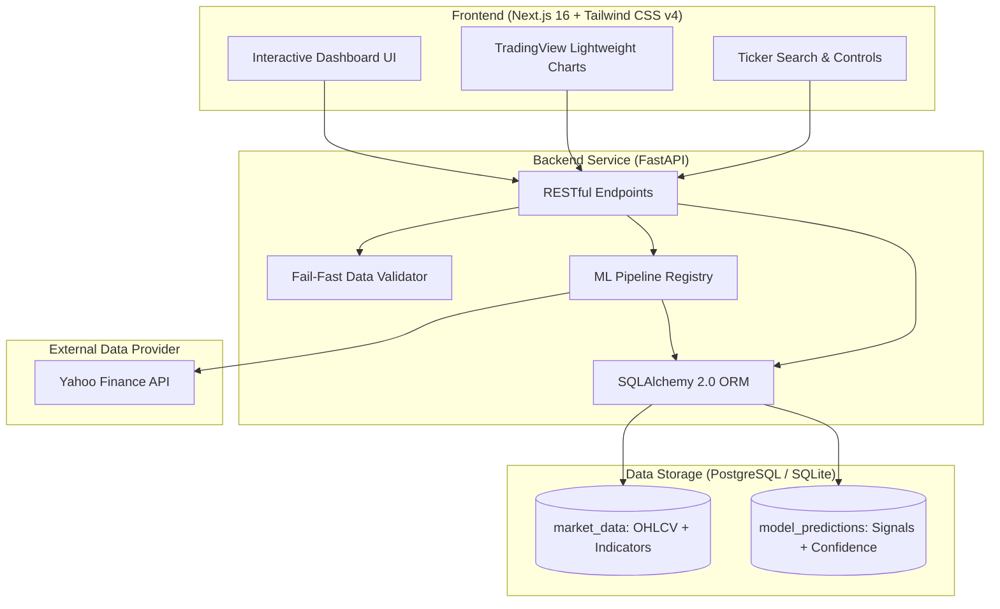

# Algorithmic Market Analyzer & Trade Classifier

[](https://github.com/Ayan13sp/banking/actions/workflows/ci.yml)
[](https://www.python.org/downloads/)
[](https://nextjs.org/)
[](https://fastapi.tiangolo.com/)
[](LICENSE)
[](backend/tests/)

A production-grade, full-stack quantitative analysis and machine learning platform designed for Indian equities (NSE & BSE). The system acquires multi-year OHLCV data from Yahoo Finance, engineers 16 mathematical and statistical indicators, trains and benchmarks multiple classification pipelines using walk-forward cross-validation, and runs a realistic backtest against a buy-and-hold benchmark — presented via an interactive Next.js dashboard powered by TradingView Lightweight Charts.


*Output of `scripts/market_analyzer.py` on RELIANCE.NS: Bollinger Bands, ML vs buy-and-hold cumulative returns, RSI-14, and Random Forest feature importances over the held-out test period.*

---

## Key Highlights & Quantitative Rigor

- **Zero Look-Ahead Bias**: Predictions generated using Day $T$'s close are executed on Day $T+1$ ($Open \to Close$). The trading engine shifts signals strictly forward by 1 step so that backtests never peek into contemporaneous intraday price action.
- **Leakage-Free Cross-Validation**: Implements `sklearn.pipeline.Pipeline` with `StandardScaler` fitted strictly inside each walk-forward fold via `TimeSeriesSplit(n_splits=3)`. Test folds and future intervals never contaminate feature scalers.
- **Dual Verification (Pandas vs SQL Window Functions)**: Computes rolling indicators in both Pandas vectorized series and PostgreSQL/SQLite window functions (`AVG(close_price) OVER (ORDER BY date ROWS BETWEEN 13 PRECEDING AND CURRENT ROW)`) to cross-validate analytical accuracy.
- **Fail-Fast Data Quality Validation**: Validates feature distributions, monotonicity of timestamps, and eliminates division-by-zero infinite values from volatility and volume spikes before model consumption.
- **Honest Financial Benchmarking**: Evaluates strategies using annualised Sharpe ratios (risk-free rate 6.5% for Indian Sovereign Yield) and acknowledges market microstructure realities rather than reporting deceptive 90%+ unfeasible accuracies.

---

## Architecture



---

## Tech Stack

| Layer | Technology | Key Capabilities |
|---|---|---|
| **Frontend** | Next.js 16 (App Router), React 19, TypeScript | Real-time SSR/CSR, Tailwind CSS v4, Responsive Layout |
| **Charting** | TradingView Lightweight Charts | Institutional-grade financial candlestick & overlay rendering |
| **Backend API** | FastAPI, Pydantic v2, Python 3.11+ | Asynchronous REST endpoints, typed schema validation, CORS |
| **ML & Quant** | scikit-learn, pandas, numpy | Pipelines, `TimeSeriesSplit`, `RandomizedSearchCV`, Random Forest, SVM, Logistic Regression |
| **Database** | PostgreSQL (Neon / Docker), SQLite | SQLAlchemy 2.0 ORM, indexed OHLCV time series, SQL window functions |
| **DevOps & CI** | Docker Compose, GitHub Actions, Render | Continuous integration (pytest, ESLint, type-checking), cloud container deployment |

---

## Machine Learning Pipeline

```
Raw OHLCV (yfinance)
       │
       ▼
Feature Engineering (16 Technical Indicators)
  ├─ Trend: SMA (14, 50, 200), EMA (14, 20, 50)
  ├─ Momentum: RSI (14), MACD (line, signal, histogram)
  ├─ Volatility: Bollinger Bands (upper, lower), ATR-14, 20-day return volatility
  └─ Volume: 20-day volume ratio, % volume change
       │
       ▼
Target Definition
  └─ y = 1 if Tomorrow's Intraday Return (Close_t+1 > Open_t+1), else 0
       │
       ▼
Chronological Train/Test Split (80% Train / 20% Test, no shuffle)
       │
       ▼
Walk-Forward CV Tuning (TimeSeriesSplit, n_splits=3)
  ├─ Pipeline 1: StandardScaler + Logistic Regression (C, penalty)
  ├─ Pipeline 2: Random Forest (n_estimators, max_depth, min_samples_split)
  └─ Pipeline 3: StandardScaler + Support Vector Machine (C, gamma)
       │
       ▼
Out-of-Sample Evaluation & Model Selection
  └─ Selected best model on validation accuracy; extract feature importances from RF
       │
       ▼
Execution-Lagged Backtesting
  └─ Day T Prediction executed on Day T+1 (Open-to-Close). Benchmarked vs Buy & Hold.
```

---

## Quick Start

### Option 1: Docker Compose (Recommended)

Spins up the FastAPI backend, PostgreSQL database, and Next.js frontend with a single command:

```bash
docker compose up --build
```

- **Frontend Dashboard**: [https://banking-frontend-46vb.onrender.com/](https://banking-frontend-46vb.onrender.com/)
- **Interactive Swagger Docs**: [https://banking-frontend-46vb.onrender.com/docs](https://banking-frontend-46vb.onrender.com/docs)

---

### Option 2: Local Development

#### 1. Backend (FastAPI)
```bash
cd backend
python -m venv .venv
source .venv/bin/activate  # On Windows: .venv\Scripts\activate
pip install -r requirements.txt -r requirements-dev.txt
uvicorn app.main:app --reload --port 8000
```
*Note: Uses SQLite (`market_analyzer.db`) automatically when no PostgreSQL connection string is provided.*

#### 2. Frontend (Next.js)
```bash
cd frontend
npm install
cp .env.example .env.local
npm run dev
```

---

## REST API Overview

| Method | Endpoint | Description |
|---|---|---|
| `POST` | `/api/analyze` | Executes complete pipeline: fetch, engineer features, train models, backtest |
| `GET` | `/api/market-data/{ticker}` | Returns stored OHLCV and 16 engineered features for candlestick charts |
| `GET` | `/api/predictions/{ticker}` | Returns model directional forecasts with probabilistic confidence scores |
| `GET` | `/api/sql-analytics/{ticker}` | Computes rolling moving averages directly in SQL using window functions |
| `POST` | `/api/backtest` | Runs realistic strategy simulation with customizable starting capital |
| `GET` | `/api/health` | Service health check |

#### Example Pipeline Execution:
```bash
curl -X POST http://localhost:8000/api/analyze \
  -H "Content-Type: application/json" \
  -d '{"ticker": "RELIANCE.NS", "years": 5}'
```
*Supported Tickers: Any valid Yahoo Finance ticker (e.g. `RELIANCE.NS`, `TCS.NS`, `INFY.NS`, `HDFCBANK.NS`).*

---

## Project Structure

```
.
├── backend/
│   ├── app/
│   │   ├── main.py            # FastAPI entry point, CORS, lifespan management
│   │   ├── config.py          # Pydantic BaseSettings environment configuration
│   │   ├── database.py        # SQLAlchemy 2.0 engine and scoped session
│   │   ├── models.py          # Database ORM schema (MarketData, ModelPrediction)
│   │   ├── schemas.py         # Pydantic v2 validation and response schemas
│   │   ├── ml_engine.py       # Feature engineering, ML pipelines, backtester
│   │   └── api_routes.py      # REST route handlers
│   ├── tests/                 # Comprehensive pytest suite (indicators, pipelines, splits)
│   ├── Dockerfile.backend
│   └── requirements.txt
├── frontend/
│   ├── src/
│   │   ├── app/               # Next.js App Router (pages and layouts)
│   │   ├── components/        # TradingView chart, Backtest card, Feature importance
│   │   └── lib/api.ts         # Typed API client
│   ├── Dockerfile.frontend
│   └── package.json
├── scripts/
│   ├── market_analyzer.py     # Standalone analytical pipeline & Matplotlib dashboard
│   └── requirements.txt
├── docs/
│   ├── market_analyzer_dashboard.png # High-resolution analytical output
│   └── INTERVIEW_GUIDE.md     # Technical deep-dive & interview Q&A guide
├── .github/workflows/ci.yml   # Multi-stage CI pipeline (pytest, ESLint, tsc)
├── docker-compose.yml         # Containerized multi-service orchestration
├── LICENSE                    # MIT License
└── render.yaml                # Production deployment blueprint (Render + Neon)
```

---

## Testing & Quality Assurance

The backend includes a dedicated test suite verifying statistical computations, absence of look-ahead bias, and pipeline validation:

```bash
cd backend
pytest -v
```

Tests verify:
1. Pure statistical indicator implementations (SMA, EMA, RSI) against ground truth math.
2. Pipeline isolation: feature scaling applied strictly inside cross-validation splits.
3. Monotonic chronological ordering and rejection of unsorted time-series data.
4. Input validation (graceful handling of division-by-zero, NaNs, and extreme volatilities).

---

## Realistic Quant Evaluation & Caveats

In quantitative finance, claims of 80–90% directional accuracy on daily liquid equities are almost universally symptoms of look-ahead bias or data leakage. This project is built around methodological integrity:
- Daily equity returns have high noise-to-signal ratios; an out-of-sample accuracy between **51% and 56%** represents realistic predictive power.
- Backtests reflect pure execution without transaction fees, slippage, or exchange turnover charges (STT in India). A real-world production deployment requires order execution simulation (e.g., VWAP/TWAP) and multi-asset risk parity weighting.

---

## Author

**Ayan Sarkar**  
Jadavpur University  
GitHub: [@Ayan13sp](https://github.com/Ayan13sp)
