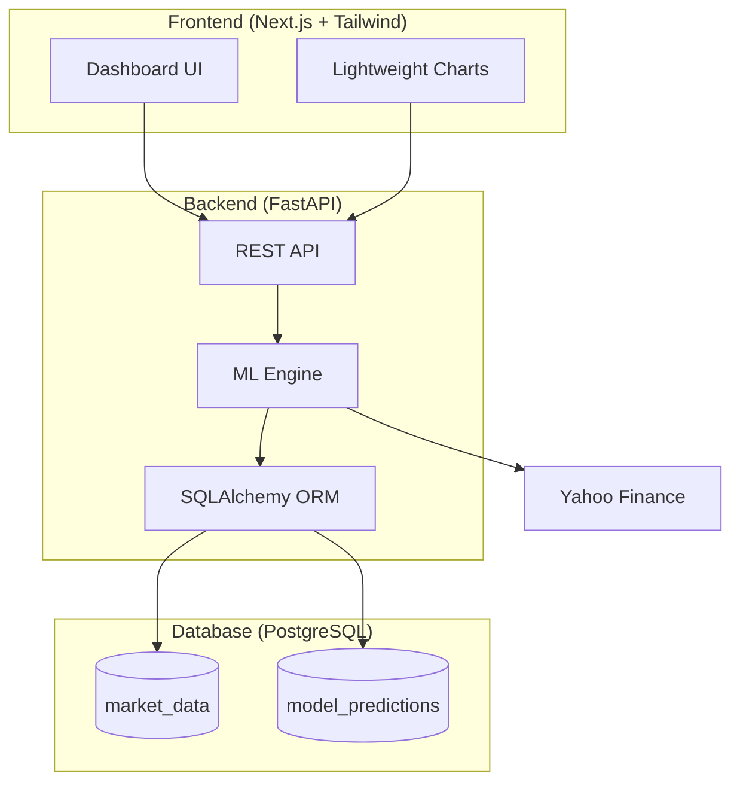

# Algorithmic Market Analyzer & Trade Classifier

[](https://github.com/Ayan13sp/banking/actions/workflows/ci.yml)

A full-stack quantitative analysis platform for Indian equities. It pulls daily price history from Yahoo Finance, engineers 16 technical indicators, trains and compares three classifiers (Random Forest, Logistic Regression, SVM) to predict next-day direction, and backtests the resulting signals against buy-and-hold, all behind a FastAPI service with a Next.js dashboard.


*Output of `scripts/market_analyzer.py` on RELIANCE.NS: Bollinger Bands, ML vs buy-and-hold cumulative returns, RSI, and Random Forest feature importances over the held-out test period.*

## Features

- **Data pipeline**: 1-10 years of daily OHLCV via `yfinance`, stored in PostgreSQL (SQLite for local dev) through SQLAlchemy.
- **Feature engineering**: SMA (14/50/200), EMA (14/20/50), RSI-14, MACD (line/signal/histogram), Bollinger Bands, ATR-14, 20-day return volatility, volume ratio and volume change.
- **Model comparison**: Random Forest, Logistic Regression and SVM, each tuned with `RandomizedSearchCV` using `TimeSeriesSplit` so cross-validation never trains on the future.
- **Backtesting**: ML strategy vs buy-and-hold with final portfolio value, return %, and annualised Sharpe ratio (risk-free rate 6.5%).
- **SQL analytics**: moving averages computed in-database with window functions as a cross-check on the pandas indicators.
- **Dashboard**: candlestick chart with indicator overlays, prediction card, backtest chart and feature importances (TradingView Lightweight Charts).

## Architecture



## Tech Stack

| Layer      | Technology                                              |
|------------|---------------------------------------------------------|
| Frontend   | Next.js 16, React 19, TypeScript, Tailwind CSS v4       |
| Charting   | TradingView Lightweight Charts                          |
| Backend    | FastAPI, Pydantic v2, SQLAlchemy 2, Python 3.11         |
| ML         | scikit-learn (RF, Logistic Regression, SVM), pandas     |
| Database   | PostgreSQL (Docker / Neon), SQLite (local default) |
| Deployment | Docker Compose, Render (app), Neon (PostgreSQL)         |
| CI         | GitHub Actions (pytest, ESLint, type-check, build)      |

## Quick Start

### Option 1: Docker (everything at once)

```bash
docker compose up --build
```

Dashboard at <http://localhost:3000>, API docs at <http://localhost:8000/docs>.

### Option 2: Run locally

**Backend** (Python 3.11+):

```bash
cd backend
python -m venv .venv && source .venv/bin/activate
pip install -r requirements.txt
uvicorn app.main:app --reload --port 8000
```

**Frontend** (Node 20+):

```bash
cd frontend
npm install
cp .env.example .env.local
npm run dev
```

The backend uses SQLite by default, so no database setup is needed for local development.

### Configuration

| Variable              | Where    | Default                       | Purpose                                      |
|-----------------------|----------|-------------------------------|----------------------------------------------|
| `DATABASE_URL`        | backend  | `sqlite:///./market_analyzer.db` | SQLAlchemy connection string               |
| `EXTRA_CORS_ORIGINS`  | backend  | empty                         | Comma-separated extra allowed origins        |
| `NEXT_PUBLIC_API_URL` | frontend | `http://localhost:8000`       | Backend base URL (baked in at build time)    |

See `backend/.env.example` and `frontend/.env.example`. The credentials in `docker-compose.yml` are for local use only.

## API Endpoints

| Method | Endpoint                    | Description                                          |
|--------|-----------------------------|------------------------------------------------------|
| POST   | `/api/analyze`              | Full pipeline: fetch, engineer features, train, backtest |
| GET    | `/api/market-data/{ticker}` | Stored OHLCV and indicators for charting             |
| GET    | `/api/predictions/{ticker}` | Model predictions with confidence                    |
| GET    | `/api/sql-analytics/{ticker}` | SMA-14/50 computed with SQL window functions       |
| POST   | `/api/backtest`             | Backtest with custom starting capital                |
| GET    | `/api/health`               | Health check                                         |

Example:

```bash
curl -X POST http://localhost:8000/api/analyze \
  -H "Content-Type: application/json" \
  -d '{"ticker": "RELIANCE.NS", "years": 5}'
```

Tickers use Yahoo Finance symbols (`.NS` for NSE, `.BO` for BSE).

## ML Pipeline

1. **Acquire**: daily OHLCV from Yahoo Finance, upserted into `market_data`.
2. **Features**: 16 indicators (listed above). Target is `1` if the next day's close is higher than today's, else `0`.
3. **Split**: first 80% of the timeline for training, last 20% held out (no shuffling).
4. **Tune and select**: three models tuned with `RandomizedSearchCV` over `TimeSeriesSplit(n_splits=3)`; the best on held-out accuracy is used for predictions. The search space is deliberately small to keep responses fast on Render's free tier.
5. **Backtest**: on days the model signals Buy, the strategy earns that day's open-to-close return; otherwise it stays in cash. Compared with buy-and-hold, with an annualised Sharpe ratio.

## Limitations

- Next-day direction from price-derived indicators is a weak signal. Accuracy close to 50% and a strategy that trails buy-and-hold are normal outcomes (the screenshot above shows exactly that), so this project is about the engineering and evaluation workflow, not a trading edge.
- Backtests ignore transaction costs, slippage and taxes, and use a single train/test split on one ticker at a time.
- The best model is picked using accuracy on the same held-out set it is reported on, which is optimistic. Nested validation would be the next step.
- Not financial advice.

## Development

```bash
# Backend tests
cd backend && pip install -r requirements-dev.txt && pytest

# Frontend checks
cd frontend && npm run lint && npx tsc --noEmit
```

## Deployment

`render.yaml` defines two Render web services (FastAPI backend, Next.js frontend). The database is external: create a free PostgreSQL project on [Neon](https://neon.tech) and set these in the Render dashboard.

| Service  | Variable              | Value                                   |
|----------|-----------------------|-----------------------------------------|
| backend  | `DATABASE_URL`        | Neon connection string                  |
| backend  | `EXTRA_CORS_ORIGINS`  | URL of the deployed frontend            |
| frontend | `NEXT_PUBLIC_API_URL` | URL of the deployed backend (then redeploy, since it is baked in at build time) |

Render's own free PostgreSQL expires after a trial period, which is why it is not used here. On the free web tier the backend also sleeps when idle, so the first request after a pause can take 50 seconds or more.

## Project Structure

```
banking/
├── backend/
│   ├── app/
│   │   ├── main.py          # FastAPI app, CORS, lifespan
│   │   ├── config.py        # Settings from environment
│   │   ├── database.py      # SQLAlchemy engine and session
│   │   ├── models.py        # ORM models
│   │   ├── schemas.py       # Pydantic request/response schemas
│   │   ├── ml_engine.py     # Indicators, training, backtesting
│   │   └── api_routes.py    # REST endpoints
│   ├── tests/               # pytest unit tests
│   └── Dockerfile.backend
├── frontend/
│   ├── src/
│   │   ├── app/             # Next.js app router pages
│   │   ├── components/      # Charts, cards, search
│   │   └── lib/api.ts       # Typed API client
│   └── Dockerfile.frontend
├── scripts/                 # Standalone version of the pipeline
├── docs/                    # Screenshots
├── docker-compose.yml
└── render.yaml
```

## Author

**Ayan Sarkar**, Jadavpur University
